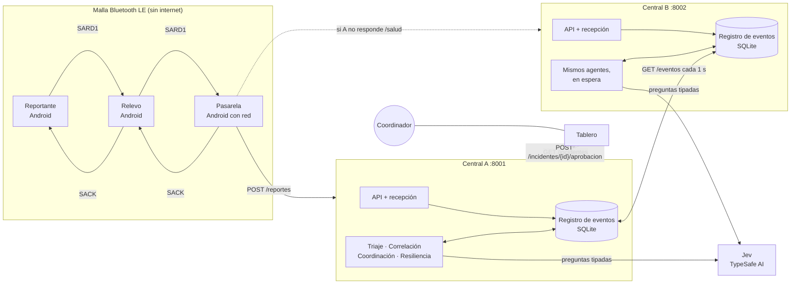
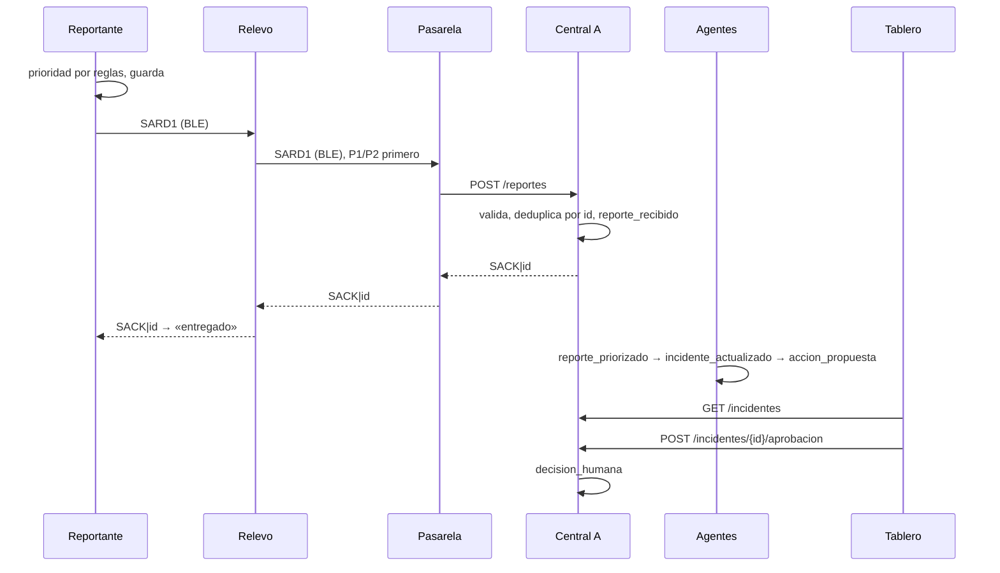
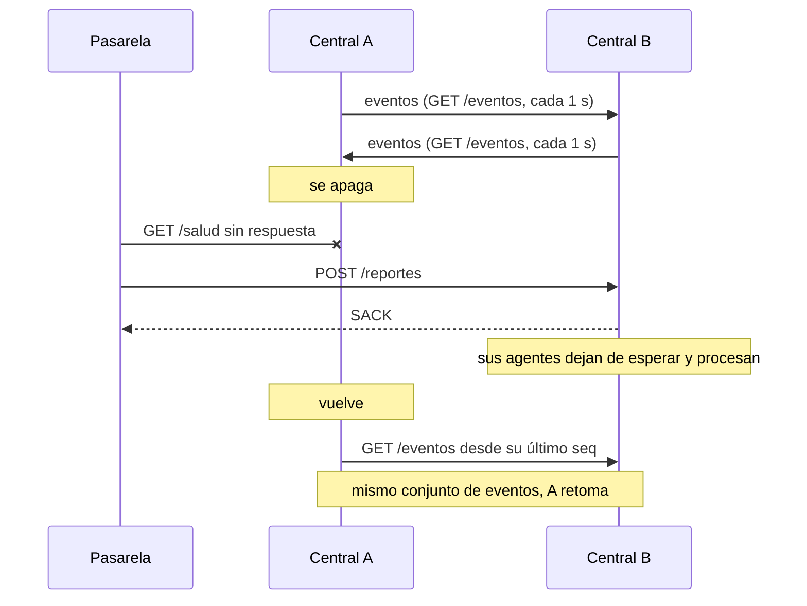

# Arquitectura

Entregable 3 de las bases (Tabla 4): diagrama de componentes, distribución de agentes, flujos de
mensajes, almacenamiento y dependencias. La central está implementada (`central/`); la app y el
tablero se describen según el contrato, y lo que su dueño aún no decidió dice «por definir».

Principio: **reglas en el borde, Jev en el centro, humanos al final.**

## 1. Componentes



| Componente | Dónde corre | Qué hace | Dueño |
|------------|-------------|----------|-------|
| Reportante | Celular Android sin red (fork de bitchat) | Formulario offline, prioridad por reglas, guarda el reporte y lo emite; muestra «entregado» al recibir `SACK` | P1 |
| Relevo | Celular Android sin red, mismo build | Guarda y reenvía reportes ajenos, P1/P2 primero sin descartar P3/P4 | P1 |
| Pasarela | Celular Android con red, mismo build | Sube los SARD1 a la central, elige A o B con `GET /salud` y devuelve los `SACK` a la malla | P1 |
| Central A y B | Python 3.12 + FastAPI + SQLite, un computador cada una (o las dos en uno) | API, registro de eventos y cinco agentes | P2 |
| Jev | Servicio externo (TypeSafe AI) | Responde preguntas tipadas sobre el texto con probabilidades calibradas | — |
| Tablero | Stack por definir | Muestra incidentes con evidencia e incertidumbre; el coordinador aprueba o rechaza | P3 |
| Simulador | Python | Modela la malla con pérdida, batería y densidad; puede enviar a la central real | P3 |

El mismo APK cumple los tres papeles de la malla; cómo se elige el papel de cada celular está por
definir (`app/README.md`).

## 2. Distribución de agentes

Todos los agentes con lógica viven en la central. En el celular solo hay reglas: no depende de
internet ni de un modelo (ADR 0004). La cola de reenvío del celular (ficha de comunicación) es un
servicio transversal, no un agente con LLM.

En la central cada agente es un proceso aparte sobre el registro de eventos (patrón pizarra): lee
lo que le falta procesar, escribe su resultado como evento nuevo y cita en `causa` el evento que
lo originó. No hay orquestador. Si un agente cae, los demás siguen, y al volver retoma lo
pendiente. Un índice único sobre `(tipo, causa)` impide responder dos veces al mismo evento, así
que dos copias de un agente no duplican trabajo. El bucle común está en
`central/agentes/ejecutor.py` y `central/iniciar.py` levanta la API y los cuatro procesos.

| Agente | Proceso | Consume | Produce | Usa Jev | Ficha |
|--------|---------|---------|---------|---------|-------|
| Recepción | Dentro de la API (`POST /reportes`) | Mensajes SARD1 | `reporte_recibido`, `reporte_duplicado`, `reporte_rechazado` y el `SACK` | No | `recepcion.md` |
| Triaje | `agentes.triaje` | `reporte_recibido` | `reporte_priorizado` | Sí: 8 preguntas Noul y una Choice de tipo | `triaje.md` |
| Correlación | `agentes.correlacion` | `reporte_priorizado` | `incidente_actualizado` | Sí: «¿mismo suceso?» y «¿lo contradice?» por candidato | `correlacion.md` |
| Coordinación | `agentes.coordinacion` | `incidente_actualizado` | `accion_propuesta` (pendiente) | No: matriz de responsabilidades y plantilla | `coordinacion.md` |
| Resiliencia | `agentes.resiliencia` | Eventos de la otra central | Copia de esos eventos, `par_caido`, `par_recuperado` | No | `resiliencia.md` |
| Comunicación | App Android | Reportes guardados y `SACK` | Cola ordenada y estado de entrega | No | `comunicacion.md` |

Las fichas están en `docs/fichas-agentes/`.

### Qué decide cada agente

- **Triaje.** La prioridad de reglas es la más alta entre la del celular, las banderas y las
  palabras críticas (`contracts/palabras-criticas.txt`, la misma lista que usa la app). Jev
  propone P1 si una señal vital pasa de 0,7 y P2 si «herido» pasa de 0,7. Queda la más alta de
  las dos: Jev puede subir una prioridad, nunca bajarla (ADR 0005). Si Jev falla, tarda más de
  8 s o no hay clave, queda la de reglas y el evento lo marca.
- **Correlación.** El código filtra incidentes a menos de 1,5 km y 2 h. Jev responde por cada
  candidato (hasta 5) si es el mismo suceso y si lo contradice. Con p ≥ 0,7 lo vincula; entre 0,3
  y 0,7 abre un incidente aparte y lo anota como posible vínculo. Sin Jev solo junta reportes de
  la misma celda, el mismo tipo y media hora de diferencia.
- **Coordinación.** Propone la entidad según el tipo (Bomberos para atrapados e incendio, Cruz
  Roja para emergencia médica y desaparecidos, Defensa Civil para vías, sala de crisis para lo
  demás), con justificación y lo que falta confirmar. Nunca ejecuta: la propuesta espera
  `POST /incidentes/{id}/aprobacion`. Si el incidente cambia, propone de nuevo y vuelve a
  `pendiente`.

## 3. Flujos de mensajes

### Reporte de punta a punta



El `SACK` sale apenas el reporte queda registrado, antes del triaje: confirma la entrega, no la
atención. Mientras no llegue, cada nodo reintenta con espera creciente (los tiempos los define la
app). Un id repetido recibe `SACK` otra vez pero no crea otro reporte; queda como
`reporte_duplicado` con la pasarela por la que llegó, para contar rutas.

### Eventos en la central

```
reporte_recibido ─triaje→ reporte_priorizado ─correlación→ incidente_actualizado
    ─coordinación→ accion_propuesta ─coordinador (API)→ decision_humana
```

Cualquier agente que falle con un evento escribe `agente_error` y lo reintenta en la siguiente
vuelta. `GET /incidentes` no guarda incidentes: los calcula cada vez a partir de los eventos
(`central/vista/`), con la evidencia por reporte, la corroboración (corroborado, sin confirmar,
posible rumor), las contradicciones y las discrepancias entre centrales.

### Caída de la central A



Las dos centrales corren a la vez y se copian los eventos en ambas direcciones, unidos por el `id`
global de cada evento. Como el registro solo crece, la unión no tiene conflictos. Los agentes de
la B revisan cada 2 s si la A responde a `/salud`; mientras responda, esperan, para no competir
por los mismos eventos. A qué central enviar lo decide la pasarela.

## 4. Almacenamiento

| Dónde | Qué guarda | Cómo |
|-------|-----------|------|
| Celular | Reportes propios y ajenos con su estado (pendiente, entregado, no entregado) | Por definir (P1). Un reporte vencido se marca, nunca se borra |
| Central | Registro de eventos | SQLite en modo WAL, un archivo por central (`central/datos/central-<nodo>.sqlite`, fuera del repo) |
| Tablero | Nada propio | Lee `GET /incidentes` |

La tabla `eventos` tiene `seq` (orden local), `id` (uuid global), `nodo` que lo creó, `tipo`,
`reporte_id`, `causa`, `datos` en JSON y `creado_en`. Unos triggers en la base rechazan todo
`UPDATE` y `DELETE` (ADR 0003), así que la regla de solo agregar se cumple aunque el código
tenga un error. Un índice único sobre `reporte_id` para `reporte_recibido` cumple la regla 3 del protocolo
(cada id se acepta una vez). La lista completa de tipos de evento está en `central/README.md`.

## 5. Dependencias

### Entre partes

| Quién | Depende de | Contrato |
|-------|-----------|----------|
| App ↔ central | Formato SARD1 y `SACK`, `POST /reportes`, `GET /salud` | `contracts/protocolo-sard1.md`, `contracts/api-central.md` |
| App ↔ central | Lista de palabras críticas compartida | `contracts/palabras-criticas.txt` |
| Tablero → central | `GET /incidentes`, `POST /incidentes/{id}/aprobacion`, `GET /salud` | `contracts/api-central.md` |
| Central A ↔ B | `GET /eventos` y `GET /salud` | `contracts/api-central.md` |
| Simulador → central | `POST /reportes` con mensajes sintéticos | `contracts/ejemplos/` |

### Externas

| Dependencia | Para qué | Si falla |
|-------------|----------|----------|
| bitchat-android (fork, GPLv3) | Malla Bluetooth LE | Plan B: transporte simulado (`docs/plan.md`, Hito 1) |
| Jev `jev-1.14.0` vía `typesafe-sdk` | Triaje y correlación | Siguen con reglas; el evento queda marcado `jev: caido` |
| FastAPI, uvicorn | API de la central | — |
| SQLite (biblioteca estándar de Python) | Registro de eventos | — |
| pygeohash | Distancia entre geohashes en la correlación | — |
| uv | Entorno y dependencias de la central | — |

La clave de Jev va en `JEV_API_KEY` del `.env`, nunca en el código. Las versiones exactas de la
central están en `central/uv.lock`.

## 6. Qué pasa cuando algo falla

| Falla | Qué hace el sistema |
|-------|---------------------|
| Un celular sin ruta a la pasarela | Guarda el reporte y reintenta con espera creciente hasta ver `SACK` |
| Llega el mismo reporte por dos rutas | La central lo acepta una vez y responde `SACK` a las dos |
| Mensaje mal formado | No recibe `SACK`; queda como `reporte_rechazado` con los motivos |
| Jev caído o lento | Triaje y correlación siguen con reglas; el tablero lo ve en `sin_analisis_ia` |
| Un agente se cae | Los demás siguen; al volver procesa lo pendiente desde el registro |
| Central A se cae | La pasarela pasa a la B; la B procesa, y la A se pone al día al volver |
| El coordinador no responde | La acción queda `pendiente`; nada se ejecuta sola |

## Por definir

- Stack del tablero.
- Cómo se elige el papel de cada celular.
- Cómo guarda los reportes el celular y los tiempos de reintento.
- Cuándo vence un reporte y la longitud máxima del texto (`contracts/protocolo-sard1.md`).
