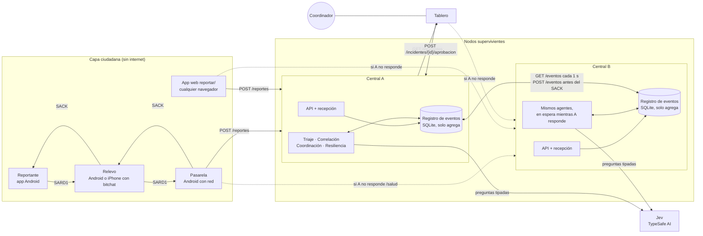
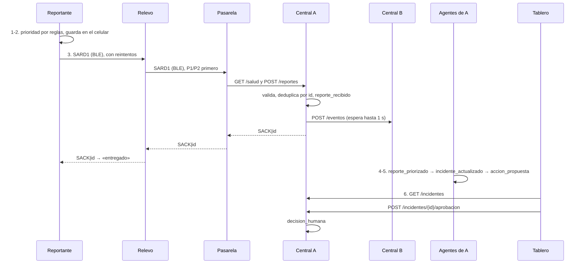
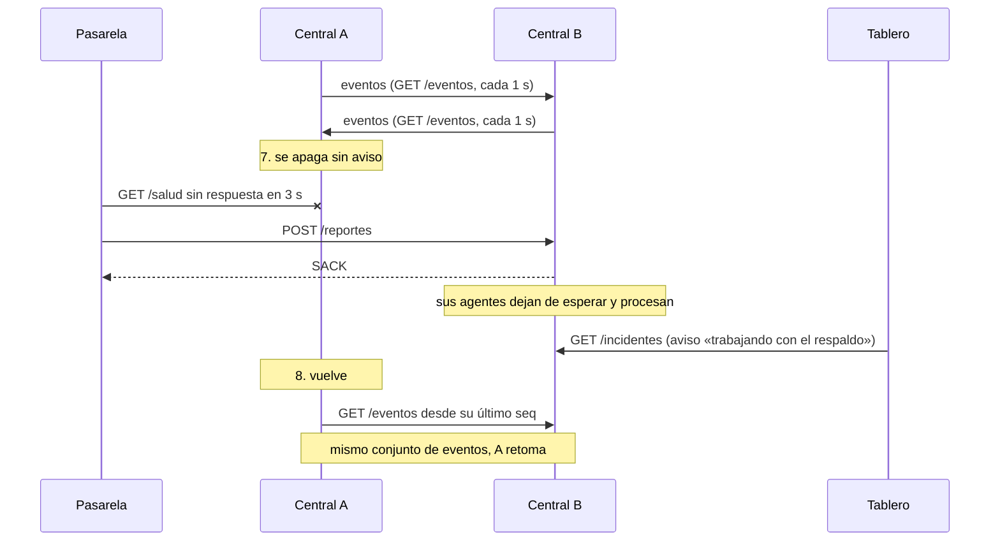

# Entregable 3 · Documento de arquitectura

Bases, Tabla 4: «diagrama de componentes, distribución de agentes, flujos de mensajes,
almacenamiento y dependencias». Describe el sistema tal como está en `main` y desplegado en
Railway. Las decisiones que lo explican están en `docs/decisiones/` (ADR 0001 a 0008).

Principio: **reglas en el borde, Jev en el centro, humanos al final.**

| Sección | Qué responde de las bases |
|---------|---------------------------|
| [1. Componentes](#1-componentes) | Diagrama de componentes y las cuatro capas de la arquitectura de referencia (Figura 7) |
| [2. Distribución de agentes](#2-distribución-de-agentes) | Dónde corre cada agente y por qué la caída de uno no paraliza el sistema (Reto 3) |
| [3. Flujos de mensajes](#3-flujos-de-mensajes) | Reporte de punta a punta, eventos en la central y caída de un nodo (recorrido de 8 pasos, sección 4.7) |
| [4. Almacenamiento](#4-almacenamiento) | Qué se guarda, dónde y cómo se evita perderlo |
| [5. Dependencias](#5-dependencias) | Entre partes y externas, con lo que pasa si fallan |
| [6. Despliegue](#6-despliegue) | Cómo corre en un computador y en internet |
| [7. Qué pasa cuando algo falla](#7-qué-pasa-cuando-algo-falla) | Resumen de la degradación |

## 1. Componentes



Las cuatro capas de la arquitectura de referencia de las bases (Figura 7) quedan así:

| Capa de las bases | En SARD |
|-------------------|---------|
| Capa ciudadana: formulario mínimo, cola local, identificador, estado de entrega | App Android (fork de bitchat) y app web `reportar/`. El id es `<dispositivo>-<contador>` y el estado es pendiente, entregado o no entregado |
| Nodos supervivientes: recepción, procesamiento, respaldo, operación de campo | Celulares relevo y pasarela en la malla; centrales A y B, que corren a la vez y se copian los eventos |
| Tejido de agentes: recepción, triaje, correlación, coordinación | Cinco agentes en la central, cada uno en su proceso, más la cola de comunicación en el celular |
| Centro de coordinación humana: cola priorizada, fuentes, incertidumbre, recomendaciones, aprobaciones | Tablero del coordinador. Nada se ejecuta sin `POST /incidentes/{id}/aprobacion` |

| Componente | Dónde corre | Qué hace | Dueño |
|------------|-------------|----------|-------|
| Reportante | Celular Android sin red (fork de bitchat-android, APK `app-v1.1`) | Formulario sin internet, prioridad por reglas, guarda el reporte y lo emite; muestra «entregado» al recibir `SACK` | P1 |
| Relevo | Celular Android con el mismo APK, o iPhone con el bitchat oficial | Guarda y reenvía reportes ajenos, P1/P2 primero sin descartar P3/P4. El iPhone los reenvía como mensajes públicos sin entenderlos (ADR 0007) | P1 |
| Pasarela | Celular Android con red, mismo APK, interruptor «Modo pasarela» | Sube los SARD1 a la central, elige A o B con `GET /salud` y devuelve los `SACK` a la malla | P1 |
| App web de reportes | Navegador de cualquier celular (`reportar/`, Next.js estático con service worker) | Arma el mismo SARD1 con las mismas reglas, lo guarda en el navegador y lo sube como su propia pasarela; sin red, lo deja copiado para pegarlo en el chat de bitchat (ADR 0007 y 0008) | P3 |
| Central A y B | Python 3.12, FastAPI y SQLite | API, registro de eventos y cinco agentes. Las dos aceptan los mismos mensajes y, sincronizadas, responden lo mismo | P2 |
| Jev | Servicio externo (TypeSafe AI, `jev-1.14.0`) | Responde preguntas tipadas sobre el texto con probabilidades | — |
| Tablero | Navegador del coordinador (`tablero/`, Next.js 16 estático, React 19, shadcn/ui y MapLibre) | Cola priorizada por secciones, mapa por barrio, evidencia, incertidumbre, boletín y aprobación. Si la A no responde, lee de la B y lo avisa | P3 |
| Simulador | Python | Modela la malla con pérdida, batería y densidad; sube a la central real; corre las pruebas E1 a E7 y el recorrido de la demo | P3 |

El mismo APK cumple los tres papeles de la malla: todo celular Android es reportante y relevo, y es
pasarela el que tiene activado «Modo pasarela» con las URL de las centrales A y B. Los colores de
la app, el tablero y la app web salen de un solo archivo, `diseno/tokens.json`.

## 2. Distribución de agentes

Todos los agentes con lógica viven en la central. En el celular solo hay reglas: no depende de
internet ni de un modelo (ADR 0004). La cola de reenvío del celular es un servicio transversal, no
un agente con LLM, como piden las bases para comunicación y resiliencia (Figura 8).

En la central cada agente es un proceso aparte sobre el registro de eventos (patrón pizarra): lee
lo que le falta procesar, escribe su resultado como evento nuevo y cita en `causa` el evento que
lo originó. **No hay orquestador ni agente central.** Si un agente cae, los demás siguen, y al
volver retoma lo pendiente leyendo el registro. Un índice único sobre `(tipo, causa)` impide
responder dos veces al mismo evento, así que dos copias de un agente no duplican trabajo. El bucle
común está en `central/agentes/ejecutor.py`, y `central/iniciar.py` levanta la API y los cuatro
procesos de agentes.

| Agente (bases, Tabla 3) | Dónde corre | Consume | Produce | Usa Jev |
|-------------------------|-------------|---------|---------|---------|
| 1 · Recepción | Dentro de la API (`POST /reportes`), porque el `SACK` va en la misma respuesta | Mensajes SARD1 | `reporte_recibido`, `reporte_duplicado`, `reporte_rechazado` y el `SACK` | No |
| 2 · Triaje | Proceso `agentes.triaje` | `reporte_recibido` | `reporte_priorizado` | Sí: 8 preguntas de sí/no y una de tipo |
| 3 · Correlación | Proceso `agentes.correlacion` | `reporte_priorizado` | `incidente_actualizado` | Sí: «¿mismo suceso?» y «¿lo contradice?» por candidato |
| 4 · Comunicación | App Android (`Cola.kt`, `Pasarela.kt`) y app web (`reportar/lib/cola.ts`) | Reportes guardados y `SACK` | Cola ordenada y estado de entrega | No |
| 5 · Resiliencia | Proceso `agentes.resiliencia` | Eventos de la otra central | Copia de esos eventos, `par_caido`, `par_recuperado` | No |
| 6 · Coordinación | Proceso `agentes.coordinacion` | `incidente_actualizado` | `accion_propuesta` pendiente de aprobación | No: matriz de responsabilidades y plantilla |

Las fichas completas están en el [entregable 4](04-fichas-agentes.md).

### Por qué la caída de un componente no paraliza el sistema (Reto 3)

| Si cae… | Lo que sigue funcionando |
|---------|--------------------------|
| Jev | Triaje y correlación siguen con reglas; el evento queda marcado `jev: caido` y el tablero lo muestra como «sin análisis de IA» |
| Un agente | Los demás siguen; lo pendiente se acumula en el registro y el agente lo procesa al volver |
| La central A | La pasarela, la app web y el tablero pasan a la B, que ya tiene los eventos; los agentes de la B dejan de esperar y procesan |
| La pasarela | Los celulares guardan y reintentan; cualquier otro Android con red puede activar el modo pasarela |
| El coordinador | Las propuestas quedan pendientes; nada se ejecuta solo |

## 3. Flujos de mensajes

### Reporte de punta a punta (pasos 1 a 6 del recorrido de integración)



El `SACK` sale apenas el reporte queda registrado en las dos centrales, antes del triaje: confirma
la entrega, no la atención. Si la B no responde en 1 s, la A da el `SACK` igual y la copia llega
después por `GET /eventos`. Un id repetido recibe `SACK` otra vez pero no crea otro reporte; queda
como `reporte_duplicado` con la pasarela por la que llegó, para contar rutas. El detalle de
reintentos, vencimiento y deduplicación está en el [entregable 5](05-protocolo-comunicacion.md).

La app web hace el mismo recorrido sin la malla: es su propia pasarela (`pasarela_id` =
`web-<dispositivo>`).

### Eventos en la central

```
reporte_recibido ─triaje→ reporte_priorizado ─correlación→ incidente_actualizado
    ─coordinación→ accion_propuesta ─coordinador (API)→ decision_humana (+ recurso_solicitado)
```

| Evento | Lo escribe | Cuándo |
|--------|-----------|--------|
| `reporte_recibido` | Recepción | Llega un SARD1 válido con id nuevo |
| `reporte_duplicado` | Recepción | Llega otra vez un id ya registrado |
| `reporte_rechazado` | Recepción | El mensaje no cumple el protocolo (con los motivos y los campos que sí llegaron) |
| `reporte_priorizado` | Triaje | Prioridad final, la de reglas y la de Jev, evidencia, fuente y motivos de revisión |
| `incidente_actualizado` | Correlación | El reporte abre un incidente o se vincula a uno |
| `accion_propuesta` | Coordinación | Entidad, recurso, acción, justificación y lo que falta confirmar; queda pendiente |
| `decision_humana` | API, por el coordinador | Aprobación o rechazo de la propuesta vigente |
| `recurso_solicitado` | API, al aprobar | El recurso queda pedido, sin unidad asignada |
| `unidad_registrada`, `unidad_estado` | API, por la entidad dueña | Registro y cambio de estado de una unidad (ADR 0006) |
| `agente_error` | Cualquier agente | Falló con un evento; se reintenta en la siguiente vuelta |
| `par_caido`, `par_recuperado` | Resiliencia | La otra central dejó de responder o volvió |

`GET /incidentes` no guarda incidentes: los calcula cada vez a partir de los eventos
(`central/vista/`), con la evidencia por reporte, la corroboración (corroborado, sin confirmar,
posible rumor), las contradicciones y las discrepancias entre centrales.

### Caída y recuperación de la central A (pasos 7 y 8)



Las dos centrales corren a la vez y se copian los eventos en las dos direcciones, unidos por el
`id` global de cada evento. Como el registro solo crece, la unión no tiene conflictos. Los agentes
de la B revisan cada 2 s si la A responde a `/salud`; mientras responda, esperan, para no competir
por los mismos eventos. A qué central enviar lo decide quien sube (pasarela o app web).

## 4. Almacenamiento

| Dónde | Qué guarda | Cómo |
|-------|-----------|------|
| Celular Android | Reportes propios y ajenos con su estado (pendiente, entregado, no entregado), intentos y próximo intento, y los ids ya confirmados | Archivo JSON en el celular (`filesDir/sard/reportes.json`, `Almacen.kt`), escrito completo en cada cambio; sobrevive a un reinicio. Un reporte vencido se marca, nunca se borra |
| App web | Los reportes hechos desde ese navegador y su estado | Almacenamiento del navegador; la página abre sin internet con su service worker |
| Central | Registro de eventos | SQLite en modo WAL, un archivo por central (`central/datos/central-<nodo>.sqlite`, fuera del repo). En Docker y en Railway, en un volumen propio de cada central |
| Tablero | Nada propio | Lee `GET /incidentes` |

La tabla `eventos` tiene `seq` (orden local), `id` (uuid global), `nodo` que lo creó, `tipo`,
`reporte_id`, `causa`, `datos` en JSON y `creado_en`. Unos triggers en la base rechazan todo
`UPDATE` y `DELETE` (ADR 0003), así que la regla de solo agregar se cumple aunque el código tenga
un error. Un índice único sobre `reporte_id` para `reporte_recibido` cumple la regla 3 del
protocolo (cada id se acepta una vez).

## 5. Dependencias

### Entre partes

| Quién | Depende de | Contrato |
|-------|-----------|----------|
| App y app web → central | Formato SARD1 y `SACK`, `POST /reportes`, `GET /salud` | `contracts/protocolo-sard1.md`, `contracts/api-central.md` |
| App, app web y central | La misma lista de palabras críticas | `contracts/palabras-criticas.txt` (la app y la app web la copian al compilar) |
| Tablero → central | `GET /incidentes`, `POST /incidentes/{id}/aprobacion`, `GET /salud` | `contracts/api-central.md` |
| Central A ↔ B | `GET /eventos`, `POST /eventos` y `GET /salud` | `contracts/api-central.md` |
| Simulador → central | `POST /reportes` con mensajes sintéticos | `contracts/ejemplos/` |

### Externas

| Dependencia | Para qué | Si falla |
|-------------|----------|----------|
| bitchat-android (fork, GPLv3) | Malla Bluetooth LE | Plan B: transporte simulado (`docs/riesgos.md`) |
| bitchat iOS (oficial) | iPhone como relevo | El iPhone reporta con la app web |
| Jev `jev-1.14.0` vía `typesafe-sdk` | Triaje y correlación | Siguen con reglas; el evento queda marcado `jev: caido` |
| FastAPI, uvicorn, pygeohash | API de la central y distancias | — |
| SQLite (biblioteca estándar de Python) | Registro de eventos | — |
| Next.js, React, shadcn/ui, MapLibre (mapcn) | Tablero y app web | — |
| uv y npm | Entornos y dependencias | — |
| Railway | Despliegue con HTTPS | Docker Compose en un computador |

La clave de Jev va en `JEV_API_KEY` (`.env` en local, variable sellada en Railway), nunca en el
código. Las versiones exactas están en `central/uv.lock`, `tablero/package-lock.json` y
`reportar/package-lock.json`.

## 6. Despliegue

| Forma | Para qué | Cómo |
|-------|----------|------|
| Recorrido del simulador | La demo de 8 pasos en un computador | `python -m simulador recorrido` (README raíz) |
| Docker Compose | Todo en un computador, cada central con su volumen | `docker compose up --build` |
| Railway | En internet con HTTPS, para celulares reales y la app web | Cuatro servicios desde el mismo repo: `central-a`, `central-b`, `tablero` y `reportar` (ADR 0008). Las centrales se sincronizan por la red privada (`central-b.railway.internal`). Pasos en `docs/despliegue.md` |

## 7. Qué pasa cuando algo falla

| Falla | Qué hace el sistema |
|-------|---------------------|
| Un celular sin ruta a la pasarela | Guarda el reporte y reintenta con espera creciente; a los 600 s lo marca «no entregado» y lo reactiva al ver un vecino nuevo |
| Llega el mismo reporte por dos rutas | La central lo acepta una vez y responde `SACK` a las dos |
| Mensaje mal formado | No recibe `SACK`; queda como `reporte_rechazado` con los motivos y el coordinador lo ve en `GET /rechazados` |
| Jev caído o lento | Triaje y correlación siguen con reglas; el tablero lo ve en `sin_analisis_ia` |
| Un agente se cae | Los demás siguen; al volver procesa lo pendiente desde el registro |
| Central A se cae | La pasarela, la app web y el tablero pasan a la B; la A se pone al día al volver |
| El coordinador no responde | La acción queda `pendiente`; nada se ejecuta sola |

## Por definir

- Si A y B van en regiones distintas de Railway (ADR 0008).
- Autenticación de la API (`docs/riesgos.md`): hoy cualquiera con la URL puede aprobar.
- La longitud máxima del texto y la antigüedad máxima del GPS (entregable 5).
